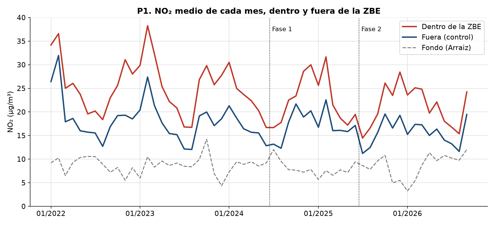
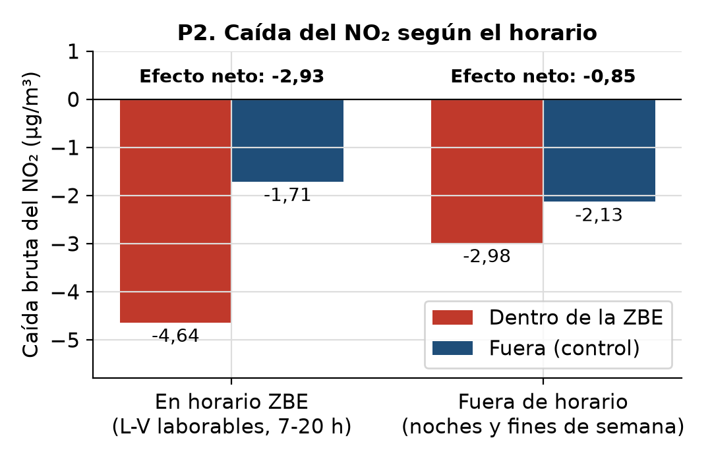
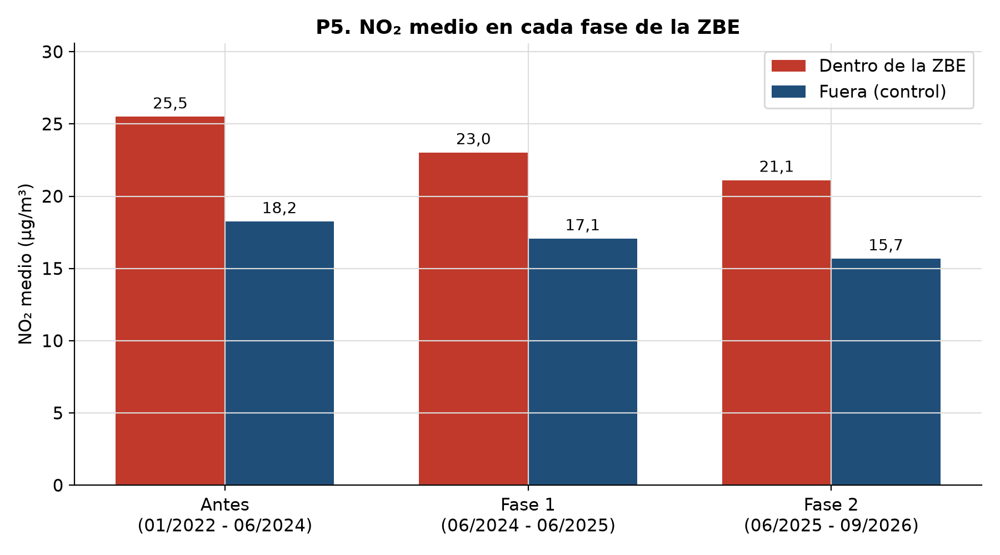

# ¿Ha reducido la ZBE de Bilbao el NO2?
### Datos para decidir si ampliar, mantener o ajustar la Zona de Bajas Emisiones

**Cliente:** Ayuntamiento de Bilbao  
**Equipo:** HaizeLab: Alfred Gabriel, Iñigo Guzmán y Kerman Latorre  
**Periodo analizado:** 01/01/2022 – 30/09/2026  
**Fecha:** Octubre de 2026  

Versión para imprimir: [Informe_Ejecutivo_ZBE_Bilbao_HaizeLab.docx](Informe_Ejecutivo_ZBE_Bilbao_HaizeLab.docx) · [Informe_Ejecutivo_ZBE_Bilbao_HaizeLab.pdf](Informe_Ejecutivo_ZBE_Bilbao_HaizeLab.pdf). Este fichero lo genera `docs/generar_informe.py` a partir de `resultados/resultados.json`.

## 1. Problema y decisión del cliente

La ZBE de Bilbao restringe la entrada de vehículos de lunes a viernes laborables, de 7:00 a 20:00: desde el 15/06/2024 (**fase 1**), a los vehículos sin etiqueta ambiental, y desde el 16/06/2025 (**fase 2**), también a los de etiqueta B de no residentes. El Ayuntamiento tiene que decidir si **amplía, mantiene o ajusta** la ZBE. Para ello necesita saber cuánto ha bajado el **NO2** (dióxido de nitrógeno, un gas que sale sobre todo de los tubos de escape) por la ZBE y cuánto habría bajado igualmente por el tiempo atmosférico o por la sustitución normal de coches viejos por otros más limpios, que ocurre con o sin ZBE.

## 2. Preguntas y prioridad

**Criterio:** cuánto cambia la respuesta la decisión. **Alta:** por sí sola puede cambiar la decisión. **Media:** comprueba una respuesta de prioridad alta.

|  | Pregunta | Prioridad | Por qué |
|---|---|---|---|
| P1 | ¿Bajó el NO2 dentro de la ZBE más que fuera? | Alta | Si no bajó más dentro, no hay motivo para mantenerla ni ampliarla. |
| P2 | ¿La bajada se concentra en el horario de la ZBE? | Alta | Dice si el horario actual está bien elegido. |
| P3 | ¿Se mantiene en las horas de viento en calma? | Media | Comprueba que P1 no se debe a que hiciera más viento. |
| P4 | ¿Baja también el SO2, que no viene del tráfico? | Media | Si bajara igual, P1 podría tener otra causa. |
| P5 | ¿Qué aportó la fase 2 respecto a la fase 1? | Alta | Dice si endurecer las restricciones ha servido. |

## 3. Datos: fuentes, tipos y calidad

| Fuente | Quién la publica | Formato y frecuencia | Variables usadas | Pregunta |
|---|---|---|---|---|
| Calidad del aire | Gobierno Vasco (Open Data Euskadi) | CSV anual; horaria | NO2 y SO2 (µg/m³), 8 estaciones | P1-P5 |
| Meteorología | Open-Meteo (modelo meteorológico, no una estación) | JSON de una API; horaria | Velocidad del viento | P3 |
| Calendario | Elaboración propia: fases y festivos de Bilbao [PENDIENTE DE VERIFICAR la fuente de los festivos] | CSV; diaria | Laborable, fase de la ZBE | P2, P5 |

**Tipos de datos.** Cada fila es una estación en una hora, con datos numéricos (NO2, SO2, viento), categóricos (estación, grupo, fase), lógicos (laborable, en horario ZBE) y de fecha y hora.

- **Filas:** 336.480 crudas, sin fechas no válidas ni repetidas. Se estudian 332.619, hasta el 30/09/2026, para que las cifras no cambien cuando se publican datos nuevos (Grafana puede mostrar datos posteriores).
- **Formato:** 199.004 celdas con coma decimal y 14.020 filas con hora 24:00 (pasa a las 00:00 del día siguiente).
- **Negativos:** 71 valores de NO2 (0,021 %) pasan a **NaN** (celda vacía). Un 0 bajaría la media sin motivo y borrar la fila perdería los demás datos de esa hora.
- **Unidades y hora:** el viento llega en km/h (media 8,85) y se pasa a m/s dividiendo entre 3,6 (media 2,46). La hora llega en GMT y se pasa a la de Madrid, que es la del horario de la ZBE.
- **Completitud** = horas con dato válido de NO2 ÷ horas que debería haber: 96,66 % en total, de 91,98 % (Mª Díaz de Haro) a 99,07 % (Erandio). Meteorología: 100 %.
- **Integración:** a cada medición se le une el calendario (por fecha) y el viento (por hora): 332.619 filas antes y 332.619 después, 0 repetidas.

## 4. Método

- **Dentro (tratamiento):** Mazarredo y Mª Díaz de Haro, dentro de la ZBE.
- **Fuera (control):** Europa, Barakaldo, Basauri, Erandio y Castrejana. Mismo tiempo atmosférico y mismo tipo de coches que el centro, pero sin ZBE: muestran lo que habría bajado el NO2 sin ella.
- **Fondo:** Arraiz, en un monte lejos del tráfico (8,73 µg/m³ antes de la ZBE, frente a 18,25 en el control). No se parece a una estación urbana, así que no entra en el control.

**Antes:** 01/01/2022 – 14/06/2024. **Después:** 15/06/2024 – 30/09/2026 (fase 1 hasta el 15/06/2025). **Caída bruta** = media después − media antes. **Efecto neto** = caída bruta dentro − caída bruta fuera (método de diferencias en diferencias, estadístico). Mirar solo dentro mezclaría la ZBE con lo que habría bajado igualmente; restar lo que bajó fuera lo separa.

**Margen de error.** Dos horas seguidas se parecen (mismo atasco, misma falta de viento) y no son datos independientes. Por eso se agrupa por semanas y se repite el cálculo 2.000 veces sorteando semanas (bootstrap). El **intervalo del 95 %** recoge el 95 % central de los resultados; si no incluye el cero, la bajada no se explica por el azar.

| Estación | Grupo | Antes | Después | Cambio (%) |
|---|---|---|---|---|
| Mazarredo | Dentro | 22,44 | 19,07 | −15,0 |
| Mª Díaz de Haro | Dentro | 28,67 | 25,03 | −12,7 |
| Europa | Fuera | 20,92 | 15,32 | −26,8 |
| Erandio | Fuera | 21,11 | 17,78 | −15,8 |
| Castrejana | Fuera | 11,67 | 10,43 | −10,6 |
| Basauri | Fuera | 19,81 | 19,31 | −2,5 |
| Barakaldo | Fuera | 17,96 | 18,70 | +4,1 |
| Arraiz | Fondo | 8,73 | 8,30 | −4,8 |

*Antes* y *Después:* NO2 medio (µg/m³) en cada periodo. *Cambio:* (Después − Antes) ÷ Antes.

## 5. Resultados

**P1. ¿Bajó el NO2 dentro más que fuera?** Dentro: 25,50 → 21,91 µg/m³ (−3,59). Fuera: 18,25 → 16,29 (−1,96). Efecto neto: −3,59 − (−1,96) = **−1,63 µg/m³** (−6,4 % del nivel de antes; intervalo de −2,38 a −0,94). *Qué significa:* de la bajada de 3,59 dentro, 1,96 se vio también fuera; la parte propia de dentro, 1,63, es la que se asocia a la ZBE. Es una estimación aproximada: de 2022 a 2023 el NO2 cambió +0,10 dentro y −1,14 fuera, así que antes de la ZBE no iban del todo en paralelo.

*Figura 1. La distancia entre la línea roja y la azul se reduce después de la fase 1.*

**P2. ¿Se concentra en el horario de la ZBE?** En horario ZBE el NO2 bajó 4,64 dentro y 1,71 fuera: efecto neto **−2,93** (intervalo de −3,82 a −2,06). Fuera de horario: −0,85 (intervalo de −1,56 a −0,19). *Qué significa:* −2,93 es un efecto neto, no una caída. La bajada propia de dentro es mayor cuando la ZBE está activa, como cabe esperar si se debe a ella.

*Figura 2. La distancia entre la barra roja y la azul de cada grupo es el efecto neto.*

**P3. ¿Se mantiene en calma?** Con viento de menos de 2 m/s, dentro pasó de 29,32 a 25,56 µg/m³ (−12,8 %); efecto neto **−1,23** (intervalo de −2,05 a −0,42). *Qué significa:* la bajada se mantiene sin viento; no se debe a que hiciera más viento.

**P4. ¿Baja también el SO2?** El SO2 apenas sale de los coches. Efecto neto: **+0,33** (intervalo de −0,01 a 0,66; Castrejana no lo mide). *Qué significa:* no baja más dentro que fuera, así que la bajada del NO2 no parece venir de una causa que afecte a todo el aire del centro.

**P5. ¿Qué aportó la fase 2?** Fase 1 frente a antes: **−1,29** (intervalo de −2,43 a −0,13). Fase 2 frente a fase 1: **−0,52** (intervalo de −1,72 a 0,74). *Qué significa:* la fase 2 no muestra una bajada adicional que se pueda distinguir de cero; la bajada propia de dentro llegó sobre todo con la fase 1.

*Figura 3. Las dos zonas bajan; lo que cuenta es cuánto más baja la barra roja de una fase a otra.*

## 6. Conclusiones y recomendaciones

**Conclusiones**

- El NO2 bajó dentro de la ZBE más que fuera: efecto neto de −1,63 µg/m³ (intervalo de −2,38 a −0,94), frente a una caída bruta de −3,59.
- Esa bajada se concentra en el horario de la ZBE (−2,93 frente a −0,85), se mantiene en calma (−1,23) y no aparece en el SO2 (+0,33).
- La fase 2 no muestra una bajada adicional distinguible de cero (−0,52; intervalo de −1,72 a 0,74).

**Recomendaciones**

- **Mantener la ZBE con su horario actual:** el efecto neto (−1,63 µg/m³) es distinto de cero y mayor cuando la ZBE está activa (−2,93).
- **No ampliar todavía con medidas como la de la fase 2:** añadió −0,52 µg/m³, dentro del margen de error. Repetir el cálculo cuando la fase 2 tenga más datos.
- **Ajustar la medición antes de ampliar:** solo hay 2 estaciones dentro y el control es desigual (Europa baja un 26,8 %, más que las de dentro). Comprobar si esa estación tuvo cambios propios, como obras, traslado o cambio de sensor [PENDIENTE DE VERIFICAR POR EL EQUIPO], y valorar más puntos de medida dentro de la ZBE.

**Limitaciones:** pocas estaciones (2 dentro y 5 de control); antes de la ZBE dentro y fuera no iban del todo en paralelo; las estaciones miden la concentración de NO2 en el aire, no lo que emiten los coches.

## 7. Herramientas

| Herramienta | Para qué | Por qué |
|---|---|---|
| Python, pandas y Jupyter | Limpiar, unir y analizar; guardar las cifras en resultados.json. | Lee CSV y fechas con zona horaria; el notebook deja juntos cálculo y resultado y se puede repetir. |
| Node-RED | Consultar las fuentes y escribir en InfluxDB de forma periódica. | Flujos visuales sin programar un servicio propio. Es automatización, no inteligencia artificial. |
| InfluxDB 2.9 | Guardar las series horarias para los paneles. | Hecha para datos con fecha y hora: agrupar por hora o día y borrar datos antiguos son funciones del motor. SQL Server (relacional, de uso general) también serviría, pero habría que diseñar las tablas y escribir esas agregaciones a mano, y no necesitamos sus relaciones entre tablas. |
| Grafana 11.2 | Paneles, alertas y permisos por equipo. | Se conecta a InfluxDB sin código intermedio. |
| Docker Compose | Arrancar todos los servicios con un comando. | Los tres miembros del equipo trabajan con el mismo entorno. |
| Servidor MCP | Consultar InfluxDB desde un asistente. | Solo lectura: no puede modificar datos. |

## 8. Orden de tareas y responsabilidades

| Paso | Tarea | Responsable y rol |
|---|---|---|
| 1 | Descarga de las fuentes | Iñigo Guzmán (Lead Data Engineer · Datos e infraestructura) |
| 2 | Limpieza y comprobación crudo frente a limpio | Iñigo Guzmán (Lead Data Engineer · Datos e infraestructura) |
| 3 | Integración de aire, calendario y meteorología | Alfred Gabriel (Product Owner · Relación con el cliente y desarrollo) |
| 4 | Análisis P1-P5, margen de error y resultados.json | Kerman Latorre (Scrum Master · Análisis y modelado) |
| 5 | Carga en InfluxDB, paneles y alertas de Grafana | Iñigo Guzmán (Lead Data Engineer · Datos e infraestructura) |
| 6 | Informe para el cliente | Alfred Gabriel (Product Owner · Relación con el cliente y desarrollo) |

Todo el equipo conoce y puede explicar el trabajo completo; la asignación indica quién lideró cada tarea.
