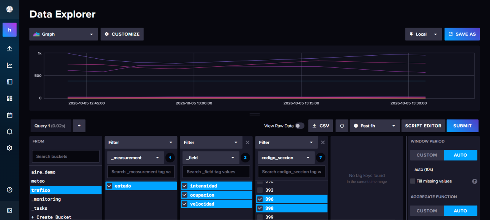
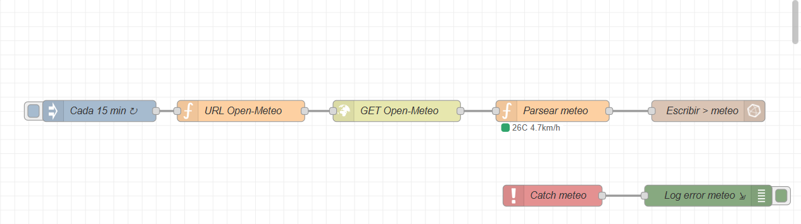
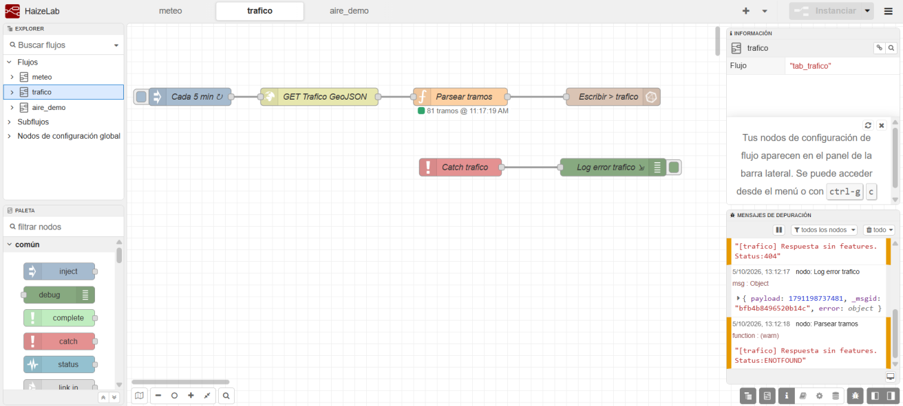
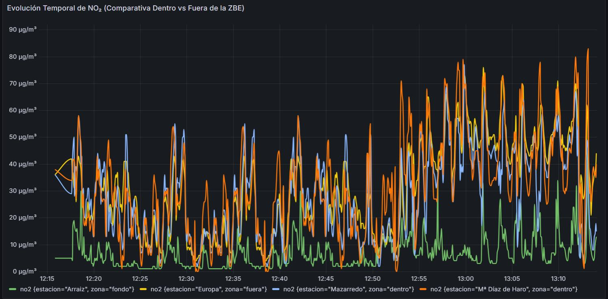
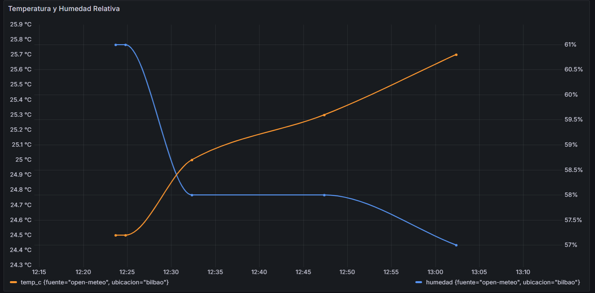
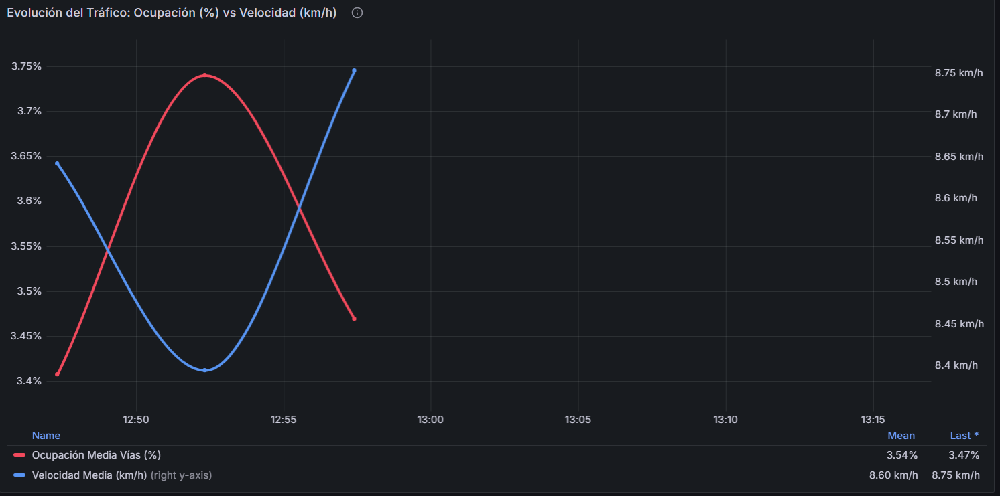

# Organigrama de Datos — HaizeLab InfluxDB 2

> Esquema completo: **Organización → Buckets → Measurements → Fields + Tags**  
> Organización: `haizenlab`. Comprobado contra lo que escriben `nodered/flows.json` e `ingesta/carga_historica.py`, consultando InfluxDB después de un arranque limpio y de la carga histórica.

---

## Diagrama general

```
haizenlab (org)
│
├── aire              ← Histórico NO₂ oficial (retención: infinita)
│   └── contaminantes
│       ├── tags:   estacion, zona
│       └── fields: no2 (float, µg/m³)
│
├── aire_demo         ← Reproducción acelerada del histórico de NO₂ (retención: 7 días)
│   └── contaminantes
│       ├── tags:   estacion, zona
│       └── fields: no2 (float, µg/m³)
│
├── meteo             ← Meteorología en tiempo real + histórico (retención: infinita)
│   └── clima
│       ├── tags:   ubicacion, fuente
│       └── fields: temp_c (float, °C)
│                   viento_kmh (float, km/h)
│                   viento_dir (float, grados)
│                   humedad (float, %)
│                   lluvia_mm (float, mm; solo tiempo real)
│
└── trafico           ← Tráfico urbano Bilbao Open Data (retención: 30 días)
    └── estado
        ├── tags:   codigo_seccion
        └── fields: intensidad (float, veh/h)
                    ocupacion  (float, %)
                    velocidad  (float, km/h)
```

Todos los valores numéricos se guardan como `float`: Node-RED y la carga histórica escriben números sin el sufijo de entero de InfluxDB. Los tags son siempre texto.

---

## Detalle por bucket

### `aire` — Histórico calidad del aire

| Elemento       | Valor                                  |
|----------------|----------------------------------------|
| Retención      | Infinita (datos históricos ZBE)        |
| Fuente         | `ingesta/carga_historica.py` (por lotes), desde `data/clean/calidad_aire_limpio.csv` |
| Token acceso   | `batch-write` (escritura en `aire` y `meteo`) |
| Measurement    | `contaminantes`                        |
| Instante       | Hora GMT de cada medición (columna `ts_gmt`) |

| Campo / Tag     | Tipo    | Descripción                              |
|-----------------|---------|------------------------------------------|
| `estacion` (tag)| string  | Nombre de la estación (Mazarredo, Mª Díaz de Haro, Europa…) |
| `zona` (tag)    | string  | `dentro` / `fuera` / `fondo`             |
| `no2`           | float   | Concentración NO₂ en µg/m³               |

Las horas sin dato de NO₂ (NaN) no se escriben.

**Ejemplo Flux:**
```flux
from(bucket: "aire")
  |> range(start: -30d)
  |> filter(fn: (r) => r["_measurement"] == "contaminantes")
  |> filter(fn: (r) => r["_field"] == "no2")
  |> filter(fn: (r) => r["zona"] == "dentro")
  |> mean()
```

---

### `aire_demo` — Demo acelerada NO₂

| Elemento       | Valor                                        |
|----------------|----------------------------------------------|
| Retención      | 7 días                                       |
| Fuente         | Node-RED `tab_demo`: lee `ingesta/no2_demo_reducido.csv` y escribe un valor horario por estación cada 5 s |
| Origen del CSV | `guardar_demo_aire()` en `ingesta/descargar_y_limpiar.py`, a partir de `data/clean/calidad_aire_limpio.csv` |
| Token acceso   | `nodered-write` (escritura en `meteo`, `trafico` y `aire_demo`) |
| Measurement    | `contaminantes`                              |
| Instante       | Hora en que Node-RED escribe el punto (no la del dato histórico) |

| Campo / Tag          | Tipo    | Descripción                          |
|----------------------|---------|--------------------------------------|
| `estacion` (tag)     | string  | Mazarredo, Mª Díaz de Haro, Europa o Arraiz |
| `zona` (tag)         | string  | `dentro` / `fuera` / `fondo`         |
| `no2`                | float   | Concentración NO₂ en µg/m³           |

**Alertas sobre este bucket:** valor horario > 200 µg/m³ y media de las últimas 24 horas > 25 µg/m³. Detalle en [alertas.md](alertas.md).

---

### `meteo` — Meteorología

| Elemento       | Valor                                          |
|----------------|------------------------------------------------|
| Retención      | Infinita (preserva histórico 2022-2026 y lecturas en tiempo real) |
| Fuente tiempo real | Node-RED `tab_meteo` (Open-Meteo, cada 15 min) |
| Fuente histórico | `ingesta/carga_historica.py`, desde `data/clean/meteorologia_limpia.csv` |
| Token acceso   | `nodered-write` (tiempo real) / `batch-write` (histórico) |
| Measurement    | `clima`                                        |

| Campo / Tag         | Tipo   | Tiempo real | Histórico | Descripción |
|---------------------|--------|:-:|:-:|-------------|
| `ubicacion` (tag)   | string | Sí | Sí | Siempre `bilbao` |
| `fuente` (tag)      | string | `open-meteo` | `historico-open-meteo` | Quién escribió el punto |
| `temp_c`            | float  | Sí | Sí | Temperatura en °C |
| `viento_kmh`        | float  | Sí | Sí | Velocidad del viento en km/h |
| `viento_dir`        | float  | Sí | Sí | Dirección del viento en grados (0-360) |
| `humedad`           | float  | Sí | Sí | Humedad relativa en % |
| `lluvia_mm`         | float  | Sí | No | Precipitación en mm |

> **Nota**: el CSV histórico tiene el viento en m/s (`viento_ms`), que es la unidad del análisis. La carga histórica lo multiplica por 3,6 al escribir en InfluxDB para que coincida con los km/h de Node-RED.

---

### `trafico` — Tráfico urbano

| Elemento       | Valor                                              |
|----------------|----------------------------------------------------|
| Retención      | 30 días (2.592.000 s)                              |
| Fuente         | Node-RED `tab_trafico` (Bilbao Open Data, cada 5 min) |
| Token acceso   | `nodered-write` (escritura en `meteo`, `trafico` y `aire_demo`) |
| Measurement    | `estado`                                           |

| Campo / Tag              | Tipo   | Descripción                                      |
|--------------------------|--------|--------------------------------------------------|
| `codigo_seccion` (tag)   | string | Código del tramo de Bilbao                       |
| `intensidad`             | float  | Vehículos por hora                               |
| `ocupacion`              | float  | % de ocupación del tramo                         |
| `velocidad`              | float  | Velocidad media en km/h (solo si es mayor que 0) |

Si un tramo no trae un valor, ese field no se escribe en ese punto.

**Alerta:** ocupación media > 35 % durante 10 min. Detalle en [alertas.md](alertas.md).

---

## Tokens de acceso — Resumen

Los crea `influxdb/init-influxdb.sh` en el primer arranque y los guarda en el volumen `influxdb_tokens`. Ninguno está en el repositorio.

| Token             | Escritura                       | Lectura         | Usado por                    |
|-------------------|---------------------------------|-----------------|------------------------------|
| Administración (`INFLUXDB_ADMIN_TOKEN`) | Todo | Todo | `influxdb_setup` para crear buckets y tokens. `carga_historica.py` lo usa solo si no encuentra `batch-write` |
| `nodered-write`   | `meteo`, `trafico`, `aire_demo` | —               | Node-RED                     |
| `batch-write`     | `aire`, `meteo`                 | —               | `carga_historica.py`         |
| `read-all`        | —                               | Los 4 buckets   | Grafana                      |
| `mcp-read-only`   | —                               | Los 4 buckets   | Servidor MCP (:5001) y chatbot |

Cada servicio tiene su propio token con el permiso mínimo: si uno se filtra, no da acceso a lo demás.

---

## Control de acceso Grafana

Usuarios, equipos, roles, dashboards visibles y pasos para comprobarlo: [permisos-grafana.md](permisos-grafana.md).

---

## Estadísticas Flux disponibles en el dashboard

| Panel                                | Función Flux                              |
|--------------------------------------|-------------------------------------------|
| Media simple (5 min)                 | `aggregateWindow(fn: mean)`               |
| Media móvil 1 h                      | `timedMovingAverage(period: 1h)`          |
| Media móvil 3 h                      | `timedMovingAverage(period: 3h)`          |
| Percentil 90                         | `quantile(q: 0.9)`                        |
| Máximo de sesión                     | `max()`                                   |
| Top 5 tramos congestión              | `sort(desc: true) |> limit(n: 5)`        |

---

## Evidencias visuales y capturas de pantalla

### 1. InfluxDB 2 — Data Explorer y Estructura de Buckets
Visualización de los cuatro buckets aprovisionados (`aire`, `meteo`, `trafico`, `aire_demo`) y consulta Flux de verificación de series temporales:


### 2. Node-RED — Orquestación de Flujos de Ingesta en Tiempo Real
Flujos activos para captura meteorológica (Open-Meteo cada 15 min), aforos de tráfico urbano (cada 5 min) y reproducción acelerada del histórico:



### 3. Grafana — Monitorización Multivariable y Control de Acceso
Cuadros de mando interactivos aprovisionados automáticamente con paneles de calidad del aire, tráfico y meteorología:



